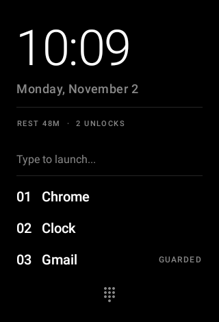
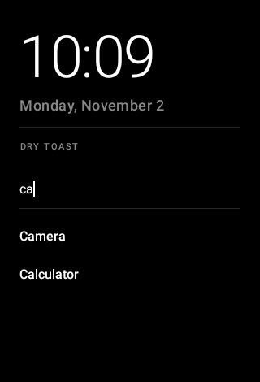
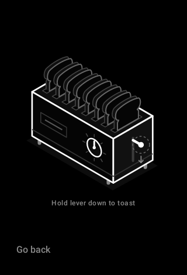
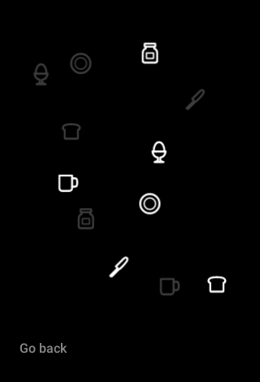

# Dry Toast

**Use your phone purposefully.**

Dry Toast (`com.garan.drytoast`) is a quiet, text-only Android launcher designed to treat your smartphone like a precision instrument rather than an entertainment console.

- **Website & Documentation:** https://drytoast.app
- **Settings Lock & Hardened Mode Console:** https://drytoast.app/console
- **Google Play:** https://play.google.com/store/apps/details?id=com.garan.drytoast
- **Direct APK Releases:** https://github.com/garanj/drytoast/releases/latest

<p align="center">
  
  &nbsp;&nbsp;
  
  &nbsp;&nbsp;
  
  &nbsp;&nbsp;
  
</p>

---

## Core Features

- **Typographic Home Screen:** No app icons, no notification badges, and no feeds. Displays only your pinned Quick Actions in plain text, subtle status info, and direct access to your dialer.
- **Zero-Latency Fuzzy Search:** Swipe up anywhere on the home screen (or tap the search prompt) with your keyboard ready. Automatically launches when a single app matches.
- **Intentional Friction Checkpoints:** Mark apps as **Allowed**, **Guarded**, or **Blocked**. Opening a Guarded app asks for a short deliberate action first: holding a deliberate pause, sorting a quick sequence, or typing your intention.
- **Cascading Focus Profiles & Triggers:** Layer profiles (such as *Work*, *Evening*, or *Weekend*) on top of your base rules. Multiple active profiles are evaluated in priority order: the first active profile that defines a rule for an app takes effect, while unspecified apps fall through to the next active profile or your base settings. Activate profiles by schedule, location, or physical NFC tag.
- **Settings Lock & Reboot-to-Apply:** Stage Settings changes until your next reboot, or lock Dry Toast Settings completely via the [Dry Toast Console](https://drytoast.app/console).
- **Optional Hardened Mode (Device Owner):** Uses Android's built-in Device Owner capability (never Accessibility Services) to suspend Blocked and resting Guarded apps at the OS level, lock Dry Toast as the persistent default launcher, and prevent impulse uninstalling.

---

## Architectural Invariants

1. **Offline by Default:** Dry Toast does not declare `android.permission.INTERNET`. There are no accounts, no cloud servers, no analytics, and no telemetry. All data resides locally on-device (`android:allowBackup="false"`).
2. **Zero Accessibility Services:** Dry Toast never uses `AccessibilityService` to inspect window titles, scrape third-party apps, or draw blocking overlays.
3. **Permanent Dialer Allowlist:** The package holding `android.app.role.DIALER` is permanently exempt from blocking, guarding, and suspension.
4. **Pure Kotlin `:core` Module:** Domain models, conflict resolution, friction policies, and fuzzy search live in `:core` with zero `android.*` imports.
5. **Low Memory Footprint:** Built to stay well under 30 MB Total PSS without retaining uncompressed icon bitmaps or leaking `Activity` instances.

---

## Repository Layout

| Path | Description |
| :--- | :--- |
| `:core` | Pure Kotlin domain models, cascading profile engine, fuzzy search, friction state machine, and port interfaces |
| `:data` | Android implementations of `:core` ports (PackageManager, DataStore, Location, NFC, Haptics, Alarms) |
| `:app` | Jetpack Compose Material 3 & Navigation 3 Android launcher UI, DPC (`DryToastDeviceAdminReceiver`), and Roborazzi screenshot tests |
| `:benchmark` | Baseline Profile generator and startup/memory benchmarks |
| `site/` | Static website (`drytoast.app`), Privacy Policy, and Settings Lock / Hardened Mode Console hosted on Firebase Hosting |

---

## Building & Testing

Requires **JDK 17** and Android SDK (API 37).

```bash
# Run Spotless formatting check and all host JVM unit + Roborazzi screenshot tests
./gradlew spotlessCheck test

# Assemble and install a debug build onto a connected Android device
./gradlew :app:installDebug

# Build a minified release APK and App Bundle
./gradlew :app:assembleRelease :app:bundleRelease
```

---

## Privacy

Dry Toast collects zero personal data and has zero network access. Read the full policy at https://drytoast.app/privacy-policy.
